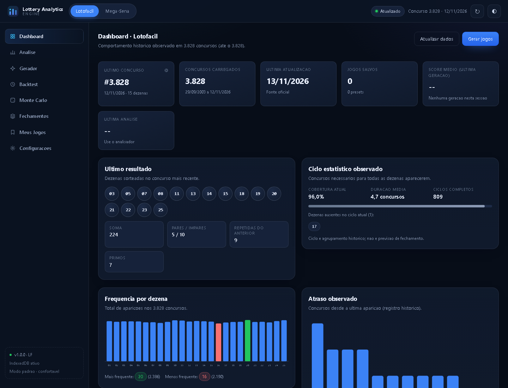

# LOTTERY ANALYTICS ENGINE

PWA analítica, **offline-first** e 100% client-side para estudar o comportamento histórico de
loterias — Lotofácil e Mega-Sena — com estatística descritiva, escore de aderência, geração
filtrada, backtesting e simulação Monte Carlo.

**Publicado em:** https://bigfatalbear.github.io/lottery-analytics-engine/



> **Sem previsão. Sem promessa de prêmio.**
> O sistema descreve o passado: frequência, atraso, ciclo, repetição, estrutura, distribuição.
> Nenhum número, escore ou combinação aumenta a probabilidade real de um sorteio futuro.

---

## Sumário

- [O que o produto faz](#o-que-o-produto-faz)
- [O que ele não faz](#o-que-ele-não-faz)
- [Stack](#stack)
- [Arquitetura](#arquitetura)
- [Estrutura do projeto](#estrutura-do-projeto)
- [Como executar localmente](#como-executar-localmente)
- [Publicação no GitHub Pages](#publicação-no-github-pages)
- [PWA, offline e cache](#pwa-offline-e-cache)
- [Worker e protocolo](#worker-e-protocolo)
- [IndexedDB](#indexeddb)
- [Datasets e pipeline de dados](#datasets-e-pipeline-de-dados)
- [Métricas estatísticas](#métricas-estatísticas)
- [Score (0–100)](#score-0100)
- [Geração, filtros e diversidade](#geração-filtros-e-diversidade)
- [Backtest e premiação](#backtest-e-premiação)
- [Monte Carlo](#monte-carlo)
- [Importação e exportação](#importação-e-exportação)
- [Segurança e privacidade](#segurança-e-privacidade)
- [Acessibilidade](#acessibilidade)
- [Performance](#performance)
- [Testes](#testes)
- [GitHub Actions](#github-actions)
- [Limitações conhecidas](#limitações-conhecidas)
- [Licença](#licença)

---

## O que o produto faz

| Área | Recursos |
| --- | --- |
| **Dashboard** | Último concurso, concursos carregados, atualização, jogos salvos, score médio, ciclo observado, frequência e atraso |
| **Raio-X estatístico** | Frequência, atraso (com Z-score), soma, paridade, primos, Fibonacci, sequências, linhas/colunas, moldura/miolo, repetição, ciclo, chi-quadrado e mapa de calor |
| **Analisador** | Volante interativo com métricas ao vivo (soma, pares, primos, moldura…), score explicado componente por componente |
| **Gerador** | Geração aleatória ou ponderada + filtros (fixas, excluídas, soma, paridade, primos, repetição, linhas, colunas, moldura, miolo) e presets |
| **Ranking** | Gera candidatos, pontua, deduplica, ordena e aplica diversidade (Jaccard) para os Top N |
| **Backtest** | Desempenho histórico dos jogos contra N concursos, distribuição de acertos, faixas e ROI quando há valores de prêmio |
| **Monte Carlo** | Estratégia vs. aleatoriedade, com percentis, histograma e comparação de ROI |
| **Fechamentos** | Distribuição de um conjunto base em N jogos, com cobertura de pares do conjunto |
| **Meus jogos** | Salvar, conferir contra o último concurso, filtrar premiados, copiar, excluir, importar e exportar |
| **Configurações** | Tema, modalidade, pesos do score, custo por jogo, janela histórica, modo avançado/compacto, benchmark e limpeza de cache |

## O que ele não faz

- Não prevê resultados e não afirma que uma dezena "vai sair".
- Não garante prêmio, retorno ou vantagem sobre a aleatoriedade.
- Não inventa valores de premiação: quando o valor não existe no dataset, exibe
  **"Premiação não calculada"**.
- Não envia dados para servidor algum, não exige conta e não coleta dados pessoais.

---

## Stack

- **HTML5 + CSS3** (variáveis, Grid, Flexbox, `prefers-color-scheme`, `prefers-reduced-motion`)
- **JavaScript ES2024+** com ES Modules — **sem framework** (sem React/Vue/Angular)
- **Web Workers** (module worker) para todo processamento pesado
- **IndexedDB** para jogos, presets, configurações, análises e cache de dataset
- **Service Worker** com estratégias por tipo de recurso
- **Web Crypto API** (`getRandomValues` para aleatoriedade real; PRNG com seed para reprodutibilidade)
- **SVG** para gráficos (`charts.js`), sem bibliotecas
- **GitHub Actions** para atualização diária dos datasets
- **Node.js** apenas para desenvolvimento, testes, geração de ícones e pipeline de dados

---

## Arquitetura

```
                    ┌──────────────────────────────┐
                    │            UI (ui.js)         │  render, eventos, modais
                    └───────────────┬──────────────┘
                                    │ handlers
                    ┌───────────────▼──────────────┐
                    │      APPLICATION (app.js)     │  orquestração, rotas, tarefas
                    └──┬────────────┬─────────────┬─┘
                       │            │             │
          ┌────────────▼───┐  ┌─────▼──────┐  ┌───▼──────────────┐
          │ STATE (state.js)│  │ DATA       │  │ WORKER CLIENT     │
          │                 │  │ (loader.js)│  │ (worker-client)   │
          └─────────────────┘  └─────┬──────┘  └───┬──────────────┘
                                     │             │ postMessage
                    ┌────────────────▼──────┐  ┌───▼──────────────┐
                    │  PERSISTENCE (db.js)  │  │ WORKER (worker.js)│
                    │  IndexedDB + fallback │  │ ANALYZE/GENERATE  │
                    └───────────────────────┘  │ RANK/BACKTEST/MC  │
                                               └───┬──────────────┘
                                        ┌──────────▼─────────────┐
                                        │ DOMAIN                 │
                                        │ statistics             │
                                        │ scoring-engine         │
                                        │ combination-engine     │
                                        │ backtest-engine        │
                                        │ monte-carlo            │
                                        │ bitmask                │
                                        └──────────┬─────────────┘
                                                   │
                                        ┌──────────▼─────────────┐
                                        │ DATA + CONFIG          │
                                        │ game-profiles, config  │
                                        │ validator, datasets    │
                                        └────────────────────────┘
```

Princípios aplicados:

- **Perfil de jogo genérico** (`GAME_PROFILE`): nenhuma regra de Lotofácil/Mega-Sena fora de
  `game-profiles.js`. Adicionar modalidade = adicionar um perfil + um arquivo de dados.
- **Núcleo puro**: `statistics`, `scoring-engine`, `combination-engine`, `backtest-engine`,
  `monte-carlo`, `bitmask` e `validator` não tocam no DOM e são testáveis no Node.
- **Sem processamento pesado na main thread**: tudo que itera sobre milhares de concursos roda no
  Worker, com progresso e cancelamento cooperativo.
- **Reprodutibilidade**: `seed` + `ALGORITHM_VERSION` + hash do dataset identificam qualquer análise.

---

## Estrutura do projeto

```
/
├── .github/workflows/update-results.yml   # pipeline diário de dados
├── data/
│   ├── lotofacil.json                     # 3.828 concursos reais
│   ├── megasena.json                      # 3.085 concursos reais
│   └── schema.json                        # JSON Schema do dataset
├── icons/
│   ├── icon.svg
│   ├── icon-192.png
│   ├── icon-512.png
│   ├── icon-maskable-512.png
│   └── apple-touch-icon.png
├── scripts/
│   ├── update-dataset.mjs                 # fetch → normaliza → valida → mescla → hash
│   ├── validate-dataset.mjs               # validação usada pelo CI
│   ├── generate-icons.mjs                 # gera PNGs sem dependências
│   └── serve.mjs                          # servidor estático local
├── src/
│   ├── css/{style,components,responsive}.css
│   ├── js/
│   │   ├── app.js               # bootstrap e orquestração
│   │   ├── config.js            # constantes, limites, defaults
│   │   ├── state.js             # estado central + store com subscribe
│   │   ├── db.js                # IndexedDB (+ fallback em memória)
│   │   ├── data-loader.js       # rede → validação → cache → offline
│   │   ├── validator.js         # schema, concursos e jogos
│   │   ├── game-profiles.js     # GAME_PROFILE (Lotofácil, Mega-Sena)
│   │   ├── statistics.js        # métricas históricas
│   │   ├── scoring-engine.js    # score 0–100 + explicações
│   │   ├── combination-engine.js# geração, filtros, ranking, fechamentos
│   │   ├── bitmask.js           # representação compacta (Uint32Array)
│   │   ├── backtest-engine.js   # backtest + motor de premiação
│   │   ├── monte-carlo.js       # comparação com aleatoriedade
│   │   ├── export.js            # importação/exportação TXT, CSV, JSON
│   │   ├── formatter.js         # formatação pt-BR
│   │   ├── charts.js            # gráficos SVG
│   │   ├── ui.js                # views, eventos, modais
│   │   ├── notifications.js     # toasts acessíveis
│   │   ├── accessibility.js     # foco, atalhos, aria-live
│   │   ├── logger.js            # log estruturado
│   │   └── worker-client.js     # correlação, progresso, cancelamento, fallback
│   └── workers/worker.js        # dispatcher do motor (também usado em fallback)
├── tests/                       # 6 suítes + runner sem dependências
├── index.html
├── manifest.json
├── sw.js
├── robots.txt
├── package.json
└── LICENSE
```

> **Desvios conscientes da estrutura original**: `bitmask.js`, `charts.js` e `logger.js` foram
> separados por responsabilidade (bitmask é exigido pelos testes; charts isola a geração de SVG;
> logger evita duplicação). `scripts/` e `tests/run.js` existem para viabilizar o pipeline e a
> execução de testes sem framework.

---

## Como executar localmente

Requisitos: Node.js 20+ (apenas para servir/testar) e um navegador moderno.

```bash
# 1. servir o site em http://127.0.0.1:8788 (simula o GitHub Pages)
npm run serve

# 2. rodar todos os testes
npm test

# 3. validar os datasets
npm run data:validate

# 4. regenerar ícones PNG
npm run icons

# 5. atualizar os datasets (requer internet)
npm run data:update
```

Não é necessário `npm install`: o projeto **não tem dependências de runtime nem de
desenvolvimento**. Abrir `index.html` via `file://` funciona parcialmente (Service Worker é
desabilitado pelo navegador nesse protocolo); use `npm run serve` para testar PWA e offline.

---

## Publicação no GitHub Pages

1. Crie o repositório e envie o conteúdo da raiz.
2. Em **Settings → Pages**, selecione **Deploy from a branch → main / (root)**.
3. Acesse `https://<usuario>.github.io/<repositorio>/`.

Todos os caminhos são **relativos** (`./src/...`, `./data/...`), e o Service Worker é registrado
com `scope: './'`, portanto a aplicação funciona tanto na raiz do domínio quanto em subdiretório.

---

## PWA, offline e cache

`sw.js` (Service Worker clássico, compatível com Safari/Firefox modernos):

| Recurso | Estratégia |
| --- | --- |
| App shell (HTML, CSS, JS, ícones) | **Cache First** com revalidação em segundo plano |
| Datasets (`./data/*.json`) | **Stale While Revalidate** (busca por caminho, ignorando `?v=`) |
| Navegação | **Network First** com fallback para `index.html` |
| Atualização manual (`?v=timestamp`) | **Network First** — ignora cache para forçar dados novos |

- `CACHE_VERSION` em `sw.js` controla a invalidação. **Ao publicar mudanças de app, incremente a
  versão** (e mantenha em sincronia com `config.js`).
- Caches antigos são removidos no `activate`.
- Após o primeiro acesso, dashboard, análises, geração, backtest, Monte Carlo, fechamentos,
  meus jogos, importação e exportação funcionam **offline**. Apenas a atualização do dataset
  depende de internet.

---

## Worker e protocolo

Requisição:

```json
{ "id": "req-1", "type": "RANK", "payload": { "gameId": "lotofacil" } }
```

Resposta:

```json
{ "id": "req-1", "type": "RANK", "success": true, "data": {}, "error": null,
  "metrics": { "elapsedMs": 412, "algorithmVersion": "1.0.0", "seeded": true } }
```

Progresso (durante a operação):

```json
{ "id": "req-1", "type": "PROGRESS", "progress": 42.5, "processed": 425, "total": 1000, "elapsed": 980 }
```

Tipos: `INIT`, `ANALYZE`, `GENERATE`, `RANK`, `BACKTEST`, `MONTE_CARLO`, `CLOSE`, `BENCHMARK`,
`CANCEL`, `PROGRESS`.

**Cancelamento cooperativo**: o Worker cede o event loop a cada ~50 iterações, permitindo processar
mensagens `CANCEL` no meio de um Monte Carlo com 50.000 simulações. Sem Worker disponível, o
`worker-client` importa o mesmo dispatcher e executa na main thread (modo fallback sinalizado na UI).

---

## IndexedDB

Banco `LotteryAnalyticsDB` (versão 1), object stores com `keyPath: 'id'`:

| Store | Conteúdo |
| --- | --- |
| `games` | jogos salvos (`game`, `numbers`, `score`, `source`, `tags`, `createdAt`) |
| `presets` | filtros salvos por modalidade |
| `analyses` | reservado para análises persistidas |
| `settings` | configurações (`id: 'app'`) |
| `cache` | dataset em cache (`dataset:<game>`), com `fetchedAt` |
| `metadata` | metadados gerais |

Se o IndexedDB estiver indisponível (navegação privada restritiva, política de storage), a camada
cai para memória, avisa o usuário e mantém a aplicação funcional na sessão.

---

## Datasets e pipeline de dados

Formato (`data/schema.json`):

```json
{
  "game": "lotofacil",
  "version": 1,
  "datasetStatus": "complete",
  "source": "official",
  "lastUpdated": "2026-11-13T21:23:33.422Z",
  "lastContest": 3828,
  "drawCount": 3828,
  "hash": "<sha256 canônico>",
  "draws": [
    { "contest": 1, "date": "2003-09-29", "numbers": [2, 3, 5], "prizes": { "11": 2, "12": 4 } }
  ]
}
```

- `prizes` mapeia **acertos → valor por ganhador**. Quando o concurso não teve ganhador em uma
  faixa, o valor é omitido; o backtest então marca aquele evento como "sem valor conhecido".
- Dados reais obtidos de fonte pública (`loteriascaixa-api`, espelho dos resultados oficiais da Caixa).
- `datasetStatus` = `complete` (começa no concurso 1, sem lacunas), `partial` ou `empty`.

### Pipeline (`scripts/update-dataset.mjs` + workflow)

```
fetch (Provider) → normalizar → validar → comparar com o arquivo atual → mesclar
→ recalcular hash → validar novamente → gravar atômico → relatório
```

Garantias implementadas:

- nunca remove concursos existentes (merge por `contest`, ordem crescente);
- nunca grava dataset inválido (`validateDataset` antes do write);
- nunca substitui histórico válido por resposta divergente/vazia;
- se a fonte principal falhar, tenta a fonte de fallback; se todas falharem, **nada é alterado**;
- gravação atômica (`tmp` + rename) e hash SHA-256 canônico.

Providers implementados: `loteriascaixa-api` (histórico completo) e `caixa-oficial` (último
concurso). O provider é isolado do processador, permitindo adicionar novas fontes sem tocar no app.

---

## Métricas estatísticas

Implementadas em `statistics.js`, todas genéricas por `GAME_PROFILE`:

- `frequency`, `relativeFrequency`, `frequencyChiSquare` (chi-quadrado + p-valor via gama incompleta)
- `delay` (atual, médio, máximo, desvio, Z-score), `averageDelay`, `expectedDelay`
- `repetitionSeries` (repetição vs. concurso anterior + faixa central histórica)
- `sumSeries`, `paritySeries`, `primeSeries`, `fibonacciSeries`, `sequenceSeries` (maior sequência),
  `lineSeries`, `columnSeries`, `frameSeries`, `coreSeries`
- `cycleAnalysis` (ciclos completos, cobertura, ausentes, progresso) e `cycleNewShareSeries`
  (proporção de dezenas novas por estágio do ciclo — usada no componente de ciclo do score)
- `spatialAnalysis` (mapa de calor), `distribution`, `summarizeSeries` (média, mediana, desvio,
  p10/p90, faixa central, distribuição), `hitsDistribution`

Todas as saídas carregam rótulos que descrevem **comportamento observado**, não previsão.

---

## Score (0–100)

```
score = ciclo×0,30 + repetição×0,25 + atraso×0,20 + estrutura×0,25
```

- Pesos configuráveis (≥ 0). Se a soma não for 100%, são normalizados automaticamente e a UI
  mostra os pesos efetivos.
- **Ciclo**: compara a proporção de dezenas ausentes no ciclo atual com a média histórica para o
  mesmo estágio do ciclo.
- **Repetição**: distância entre as dezenas repetidas e a distribuição histórica (gaussiana).
- **Atraso**: média dos Z-scores de atraso das dezenas escolhidas.
- **Estrutura**: soma, paridade, primos, Fibonacci, sequência, linhas/colunas, moldura, miolo —
  cada um pontuado pela proximidade da faixa central histórica (p10–p90).
- Cada resultado inclui `reasons[]` (com os números reais da combinação) e `warnings[]`
  (incluindo o aviso de que score **não é probabilidade**).

O score mede **aderência aos critérios escolhidos**, não chance de prêmio.

---

## Geração, filtros e diversidade

- Amostragem sem reposição com PRNG criptográfico (`crypto.getRandomValues`) ou PRNG determinístico
  (mulberry32) quando há seed.
- Filtros: dezenas fixas/excluídas, pares, ímpares, soma, primos, Fibonacci, repetição, sequência
  máxima, linhas, colunas, moldura, miolo.
- Estratégia de reparo: amostragem + busca local com teto de tentativas (nunca enumera o espaço
  combinatório; 3.268.760 combinações no Lotofácil, 50.063.860 na Mega-Sena).
- Deduplicação por bitmask e **diversidade por similaridade de Jaccard** para o Top N.
- Estratégias heurísticas: conservadora, balanceada, diversificada, alta frequência, baixa
  frequência, atraso, aleatória — explicitamente rotuladas como heurística.
- `seed` reproduz exatamente a mesma geração (mesma versão de algoritmo).

---

## Backtest e premiação

Entrada: jogos, concursos, janela, custo por jogo.
Saída: jogos, concursos, custo total, retorno bruto, retorno líquido, ROI, médias, distribuição de
acertos, estatísticas por faixa, melhor/pior resultado e notas.

- ROI só é calculado quando há **custo informado** e **valores de prêmio reais** no período.
- Caso contrário: `ROI histórico: Não calculado` / `Premiação não calculada`, sem inventar valores.
- Faixas sem ganhador no concurso (valor ausente) são contabilizadas como "sem valor conhecido".

---

## Monte Carlo

Compara a estratégia real contra jogos aleatórios no **mesmo período**:

- N simulações configuráveis (500 a 50.000), janela de concursos configurável;
- saída: média/mediana/desvio/mín/máx, percentis p5–p99, histograma, diferença absoluta/relativa,
  percentil da estratégia, comparação de ROI;
- progresso e cancelamento cooperativo no Worker;
- interpretação explícita: diferenças dentro da variação esperada **não indicam vantagem real**.

---

## Importação e exportação

- **Importar**: `.txt`, `.csv`, `.json` (array de arrays, array de objetos `{numbers}`, ou
  `{games:[...]}`). Tudo é validado antes de salvar; jogos inválidos e duplicados são reportados.
  Nenhum conteúdo importado é executado.
- **Exportar jogos**: TXT (uma linha por jogo), CSV (`;` com cabeçalho) e JSON com metadados.
- **Exportar análise**: JSON completo com metadados (algoritmo, hash do dataset, seed) e CSV de
  indicadores.
- **Exportar backtest**: CSV. Tudo via `Blob` + `URL.createObjectURL` — funciona offline.

---

## Segurança e privacidade

- **CSP** restritiva: `default-src 'self'; script-src 'self'; object-src 'none'; base-uri 'self'` —
  sem `eval`, sem `new Function`, sem JavaScript inline (todos os handlers usam `addEventListener`).
- Todo texto dinâmico entra por `textContent` ou por `escapeHtml`; nenhuma interpolação direta de
  dados importados em HTML.
- Nenhuma API key, token ou senha é armazenada. Nenhum dado sai do dispositivo.
- Sem conta, sem login, sem analytics, sem cookies de terceiros.
- Dados importados são sanitizados (controle de caracteres, limites de tamanho e de arquivo: 8 MB).

---

## Acessibilidade

- Navegação completa por teclado, `skip-link`, foco visível, `aria-current`, `aria-pressed`.
- Modais com `role="dialog"`, `aria-modal`, aprisionamento de foco e fechamento por `Esc`.
- Regiões `aria-live` para notificações e progresso.
- `prefers-reduced-motion` respeitado (e opção de desligar animações nas configurações).
- Contraste alto suportado; tabelas com cabeçalhos semânticos; rótulos em todos os campos.

---

## Performance

- Processamento pesado no Worker; main thread apenas renderiza.
- Bitmask em `Uint32Array` com popcount SWAR: nenhuma conversão para string binária em loop.
- Paginação de resultados (25 por página), `DocumentFragment`/renderização por template,
  `requestAnimationFrame` para reagendar renders, `debounce` implícito por ação.
- Benchmark embutido (Configurações → Executar benchmark) mede geração e pontuação de 1.000 jogos
  no hardware atual — sem prometer tempos absolutos, que variam por dispositivo.
- Teto de candidatos (`LIMITS.maxCandidates`) e de simulações para evitar consumo descontrolado.

---

## Testes

Runner próprio, sem dependências externas: `npm test` (75 testes).

```
validator     validação de dataset, concursos, jogos, importação
statistics    médias, percentis, frequência, atraso, ciclo, chi-quadrado
scoring       normalização de pesos, faixas 0–100, explicações, métricas estruturais
bitmask       encode/decode, popcount, interseção, Jaccard, 60 dezenas (2 palavras)
combination   binomial, PRNG, filtros, dedupe, diversidade, fechamento, parsing
backtest      acertos, prêmios, ROI, janelas, Monte Carlo
integridade   todos os módulos carregam + datasets válidos (>100 concursos, começa no #1)
```

---

## GitHub Actions

`.github/workflows/update-results.yml`:

- **cron diário** (`15 6 * * *` UTC) e `workflow_dispatch` com `game` e `dry_run`;
- `checkout` → `setup-node` (LTS) → `update-dataset.mjs` → `validate-dataset.mjs` → `npm test`;
- publica `data/report.json` como artefato;
- **commit apenas se `data/*.json` mudou** (nunca duplica concurso, nunca apaga histórico);
- `permissions: contents: write` e `concurrency` para evitar execuções concorrentes.

> **Pendência desta publicação inicial:** o token OAuth usado no primeiro `push` não possui o
> escopo `workflow`, então o arquivo ficou em [`docs/update-results.workflow.yml`](docs/update-results.workflow.yml)
> (cópia idêntica, com nota no topo). Para ativar o pipeline:
>
> ```bash
> gh auth refresh -s workflow
> git mv docs/update-results.workflow.yml .github/workflows/update-results.yml
> git commit -m "ci: ativa atualizacao automatica de resultados" && git push
> ```
>
> Remova também a linha de `.git/info/exclude` que ignora o arquivo localmente.

---

## Limitações conhecidas

- Loterias são independentes e uniformes por lei: nenhuma análise altera probabilidade real.
  O sistema é uma ferramenta de estudo de séries históricas, não de previsão.
- O dataset depende de fonte pública; o workflow mantém atualização diária, mas atrasos da fonte
  podem adiar a entrada de um concurso.
- Preços de aposta e valores de prêmio variam ao longo do tempo; ROI é sempre histórico e depende
  dos valores presentes no dataset.
- Comparação de estratégias é feita pelo backtest por fonte + Monte Carlo contra a aleatoriedade;
  não há um painel dedicado de múltiplas estratégias lado a lado.
- O Service Worker serve JS/CSS em modo *cache-first*: ao publicar mudanças, incremente
  `CACHE_VERSION` em `sw.js`.

---

## Licença

MIT — consulte [LICENSE](./LICENSE). O aviso legal também se aplica ao uso dos dados e das análises.

---

**LOTTERY ANALYTICS ENGINE** · análise estatística responsável, 100% local.
